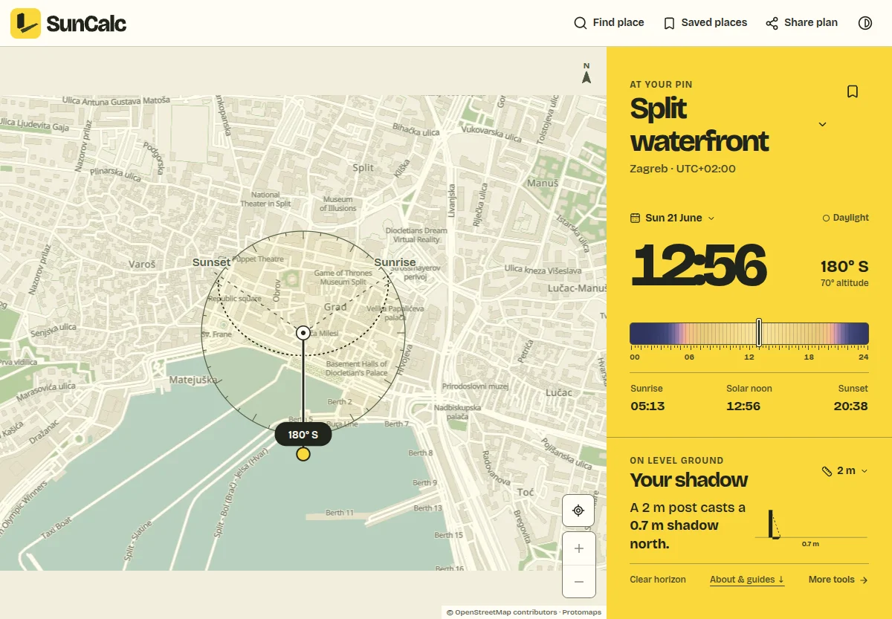

# SunCalc.app · Sun and shadow planner

See where the sun will be and how long a shadow it casts. Choose a place,
scrub the day, compare seasons and share a precise moment—without an account.

**[Open the planner](https://suncalc.app/) · [Read the guides](https://suncalc.app/guides/) · [Try a June example](https://suncalc.app/#lat=43.5083&lon=16.4383&at=2026-06-21T10%3A56%3A03.155Z&place=Split+waterfront)**



Map: © OpenStreetMap contributors · Protomaps.

## What you can do

- Find a town, enter coordinates, drop a pin, or optionally use your location.
- Read sun direction, altitude, sunrise, solar noon, sunset and golden-light events.
- Compare the solstices and estimate an upright object's shadow on level ground.
- Save places locally and share a pin with its exact date and time.
- Install the PWA and reopen the planner offline, with recently viewed map detail.
- Use Auto, Light or Dark appearance with first-party maps, fonts and scripts.

The app models a **clear, level horizon**. Buildings, trees, terrain and weather
are not modelled. It does not predict the actual shaded area of a property.

## Privacy and pricing

No accounts, ads, cookies or analytics identifiers. Saved places stay in your
browser. Shared coordinates and times stay in URL fragments. The hosted service
uses first-party aggregate usage counters; explicit address lookup uses Geoapify.
Read the [privacy and accuracy notes](https://suncalc.app/about/).

The complete hosted planner is **free during preview**. No trial clock is running
and no payment is taken. The planned paid release includes 30 full days, then
**€1 once per browser installation**. Today's sunrise and sunset stay free.

Original code is MIT-licensed, including commercial reuse and self-hosting.
Hosted-service pricing does not limit those license rights. Third-party maps,
data and fonts retain their own [licenses and attribution](THIRD_PARTY_NOTICES.md).

## Run locally

Use Node 22.13+ and npm from the repository root:

```sh
npm ci
npm run ci
npx wrangler d1 migrations apply suncalc-app --local
npm run preview
```

Open `http://127.0.0.1:8789`. This serves the production bundle, local D1 and the
bundled Split map without credentials. For live UI editing, run `npm run dev`
in another terminal. Unbundled global map detail and optional address lookup
need your own service configuration; the solar calculations work locally.

For browser checks:

```sh
npx playwright install chromium
npm run test:browser
```

Or set `CHROME_BIN` to an installed Chrome executable. Tests cover independent
US Naval Observatory references, daylight-saving transitions, polar conditions,
privacy, sharing, offline reopening and public-page navigation.

## Contribute

Read [CONTRIBUTING.md](CONTRIBUTING.md), browse the [roadmap](ROADMAP.md), or
[open an issue](https://github.com/matijarma/suncalc.app/issues). Reports with a
public example location, date, time zone and expected result are especially useful.

SunCalc.app is an independent project by Matija Radeljak. It is not affiliated
with SunCalc.org, SunCalc.net or the SunCalc JavaScript library. Calculations
use [Astronomy Engine](https://github.com/cosinekitty/astronomy).

[Operations and map-data reproduction](docs/operations.md) ·
[Launch materials](docs/launch.md) · [MIT license](LICENSE)
